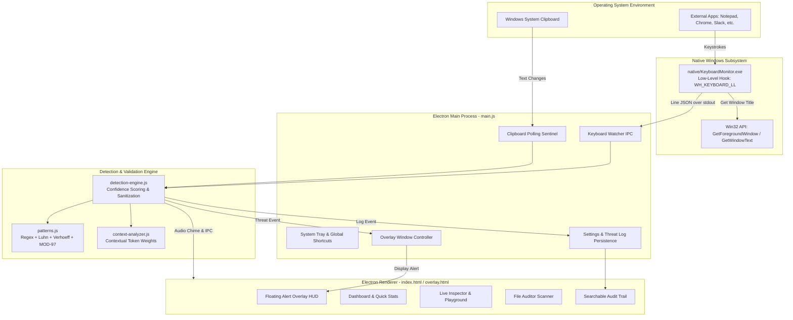

# PII Guard Desktop — System-Wide Data Protection & DLP Sentinel

<div align="center">


**Next-generation, real-time desktop Data Loss Prevention (DLP) and Personally Identifiable Information (PII) sentinel.**  
*Protects sensitive data across your entire operating system before it leaks.*

[Key Capabilities](#key-capabilities) • [System Architecture](#system-architecture) • [Supported PII & Algorithms](#supported-pii-categories--validation-algorithms) • [Installation & Setup](#installation--setup) • [Project Structure](#project-structure) • [Native Keyboard Hook](#native-keyboard-sentinel-c) • [Security & Privacy](#security--zero-trust-privacy)

</div>

---

## Overview

Unlike standard browser extensions that only inspect web form inputs inside a single browser tab, **PII Guard Desktop** acts as an autonomous, operating system-wide defense layer. It continuously intercepts, analyzes, and guards sensitive data across **all desktop applications**—including:

- **Text Editors & IDEs**: Notepad, VS Code, Sublime Text, Notepad++
- **Communication & Chat**: Microsoft Teams, Slack, Discord, Telegram, WhatsApp Desktop
- **Web Browsers**: Google Chrome, Mozilla Firefox, Microsoft Edge, Brave
- **Office Suites**: Microsoft Word, Excel, PowerPoint, Google Docs
- **Command Consoles**: PowerShell, Command Prompt, Windows Terminal

Whether sensitive data is being **typed in real time**, **copied to the clipboard**, or **stored inside local files**, PII Guard detects threats instantly, presents an always-on-top visual warning overlay, plays an alert chime, and offers 1-click redaction.

---

## Key Capabilities

### 1. Real-Time Global Keystroke Sentinel
- Hooks into Windows low-level keyboard messages via a dedicated native C# background monitor ([native/KeyboardMonitor.cs](file:///c:/Users/radha/OneDrive/Desktop/PII-Guard-Chrome-Extension%20-%20Copy/native/KeyboardMonitor.cs)).
- Identifies the active foreground application window (e.g., `Notepad`, `Slack`, `Chrome`).
- Analyzes typed text through a high-speed sliding buffer and alerts you the moment you finish typing a sensitive number or credential.

### 2. Always-On-Top Floating Alert Banner ([overlay.html](file:///c:/Users/radha/OneDrive/Desktop/PII-Guard-Chrome-Extension%20-%20Copy/overlay.html))
- A sleek, translucent, non-intrusive floating HUD window appears in the corner of your screen when PII is detected in an external window.
- Displays the target application name (`[Typing in Notepad]`), PII classification, confidence score, and a masked preview with an automatic countdown dismissal.

### 3. System-Wide Clipboard Sentinel & 1-Click Sanitizer
- Runs continuously in the background or minimized to the Windows System Tray.
- Scans clipboard contents automatically upon any copy/cut operation across the OS.
- Provides immediate **"Mask PII"** action that replaces sensitive data in the clipboard with redacted tokens (e.g., `•••• •••• •••• 1234` or `••••••••1234`) before accidental pasting.

### 4. Live Inspector & Form Context Simulator
- Dedicated interactive workbench to paste or type arbitrary text snippets.
- Real-time token highlighting and confidence breakdowns (High, Medium, Low).
- Context Simulator: test how field labels (`"credit card"`, `"aadhaar"`, `"order id"`, `"tracking code"`) modulate detection scores and eliminate false positives.

### 5. Document & File Auditor
- Drag-and-drop file scanner for text, source code, data, and log files (`.txt`, `.csv`, `.json`, `.log`, `.env`, `.xml`, `.md`).
- Generates a full threat audit with line-by-line findings.
- **1-Click Export Sanitized File**: Saves a clean, redacted copy of the audited file.

### 6. Threat Log & Audit Trail
- Persistent, searchable, and filterable log of all intercepted PII events.
- Displays timestamps, source (Typing vs. Clipboard vs. File), active application, detection rule, severity level, and masked snippets.
- Export audit reports directly to **CSV**.

### 7. Synthesized Audio & Visual Alerts
- Synthesized audio warning chimes via the Web Audio API (zero audio asset dependencies).
- Native OS desktop notifications for background events.
- Quick tray controls to pause/resume monitoring or summon the dashboard (`Ctrl+Shift+P`).

---

## System Architecture



---

## Supported PII Categories & Validation Algorithms

PII Guard does not rely on naive pattern matching alone. It combines regular expressions, mathematical checksums, network identification, and negative context scoring:

| Category | Validation & Checksum Mechanism | Threat Level |
| :--- | :--- | :---: |
| **Credit / Debit Cards** | **Luhn Checksum** (Mod-10) + Card Network BIN Identification (Visa, Mastercard, American Express, RuPay, Discover, Diners Club) | `CRITICAL` |
| **Indian Aadhaar Number** | 12-Digit Format + **Verhoeff Algorithm Checksum** validation | `CRITICAL` |
| **US Social Security (SSN)** | Area, Group, and Serial Number validation (excludes invalid 000, 666, 900-999 prefixes) | `CRITICAL` |
| **Indian PAN Card** | 10-Character Alphanumeric Tax ID Format (`[A-Z]{5}[0-9]{4}[A-Z]`) | `CRITICAL` |
| **International Bank Account (IBAN)** | Country code length validation + **IBAN MOD-97 Checksum** | `CRITICAL` |
| **Passport Numbers** | Alpha-Numeric international passport formats | `CRITICAL` |
| **Cryptocurrency Wallets** | Bitcoin (Legacy `1...`, SegWit `3...`, Bech32 `bc1...`) & Ethereum (`0x...` 40-hex) | `CRITICAL` |
| **Indian Driving Licenses** | RTO State Code + Issue Year + 7-digit numeric serial validation | `WARNING` |
| **Indian Voter ID (EPIC)** | 3-Letter Alpha prefix + 7-Digit Serial | `WARNING` |
| **Indian Bank IFSC Codes** | 11-Character RBI standard (`[A-Z]{4}0[A-Z0-9]{6}`) | `WARNING` |
| **Phone / Mobile Numbers** | International E.164 and National 10-digit formats with prefix verification | `WARNING` |
| **Email Addresses** | RFC 5322 compliant email syntax verification | `NOTICE` |
| **IPv4 Addresses** | Validates 4-octet ranges (0–255) with private/public range differentiation | `NOTICE` |
| **Postal Codes** | Indian 6-Digit PIN Codes & US ZIP / ZIP+4 formats | `NOTICE` |

---

## Native Keyboard Sentinel (C#)

The desktop application includes a dedicated native C# component: [native/KeyboardMonitor.cs](file:///c:/Users/radha/OneDrive/Desktop/PII-Guard-Chrome-Extension%20-%20Copy/native/KeyboardMonitor.cs).

### Key Technical Aspects:
- **Zero Polling Overhead**: Utilizes the Windows Win32 `SetWindowsHookEx` API with `WH_KEYBOARD_LL (13)`. It receives event-driven OS notifications only when physical keys are pressed.
- **Window Context Tracking**: Simultaneously calls `GetForegroundWindow` and `GetWindowText` to identify which program is currently active.
- **Transparent Key Forwarding**: Calls `CallNextHookEx` so that user typing is never delayed, blocked, or altered.
- **Crash & Orphan Protection**: Runs a background `stdin` watcher thread. When the parent Electron process terminates or the communication pipe closes, the monitor exits cleanly (`Environment.Exit(0)`), preventing zombie background processes.
- **Automatic JIT Compilation**: If `native/KeyboardMonitor.exe` is absent, [main.js](file:///c:/Users/radha/OneDrive/Desktop/PII-Guard-Chrome-Extension%20-%20Copy/main.js#L554-L574) automatically discovers the local Windows .NET Framework compiler (`csc.exe`) and builds the binary on the fly.

---

## Project Structure

```
PII-Guard-Chrome-Extension - Copy/
├── native/
│   ├── KeyboardMonitor.cs     # C# Win32 low-level keyboard hook & window detector
│   └── KeyboardMonitor.exe    # Compiled 64-bit native monitoring binary
├── main.js                    # Electron main process (tray, overlay, clipboard & native monitor)
├── preload.js                 # Secure contextBridge IPC bridge
├── index.html                 # Main dashboard UI (Dashboard, Inspector, Auditor, Threat Log)
├── styles.css                 # Cyber-defense dark theme & responsive micro-animations
├── renderer.js                # Frontend controller, state sync, Web Audio chime & views
├── overlay.html               # Always-on-top floating alert HUD window
├── patterns.js                # Core regex definitions, Luhn, Verhoeff, & MOD-97 algorithms
├── detection-engine.js        # Confidence scoring, threat categorizer, & auto-redaction
├── context-analyzer.js        # DOM & input context evaluation (reduces false positives)
├── package.json               # Project manifest, dependencies, and build scripts
└── README.md                  # Detailed system documentation
```

---

## Installation & Setup

### Prerequisites
- **Operating System**: Windows 10 or Windows 11 (64-bit recommended for native keyboard hook).
- **Runtime**: [Node.js](https://nodejs.org/) (v18.0.0 or higher).
- **.NET Framework**: Windows .NET Framework 4.0+ (pre-installed on virtually all modern Windows machines).

### Step 1: Install Dependencies
Open a terminal in the project directory:
```bash
npm install
```

### Step 2: (Optional) Build Native Keyboard Helper
The native binary is compiled automatically by `main.js` if missing. To compile it manually at any time:
```bash
npm run build:native
```

### Step 3: Launch the Application
```bash
npm start
```

---

## Usage Guide

### 1. Global Keyboard Shortcut
Press **`Ctrl + Shift + P`** (or `Cmd + Shift + P` on macOS) from **any application** to instantly bring the PII Guard console to the foreground.

### 2. Testing Real-Time Typing Protection
1. Keep PII Guard running (or minimized to the system tray).
2. Open **Notepad**, **Google Chrome**, or any text editor.
3. Type a sample test Aadhaar number or test payment card:
   - Example (Indian Aadhaar): `9999 4105 1548`
4. Notice the **floating on-screen alert overlay** popping up in the bottom-right corner showing `[Typing in Notepad]`, accompanied by an audible warning chime!

### 3. Testing Clipboard Sanitization
1. Copy any sensitive text string to your clipboard.
2. Click **"Mask PII"** on the sidebar widget (or enable *"Auto-Mask Clipboard"* in **Preferences**).
3. Paste into any document—sensitive digits will be cleanly redacted.

### 4. Running a File Audit
1. Navigate to the **File Auditor** tab.
2. Drag and drop any `.txt`, `.csv`, `.log`, or `.json` file into the upload zone.
3. Review detected items, danger levels, and click **Export Redacted File**.

---

## Security & Zero-Trust Privacy

- **100% Local Execution**: All regex matching, checksum validations, and context parsing run entirely inside your local Node.js and Electron instance.
- **Zero Cloud Transmission**: No keystrokes, clipboard text, or file contents are ever sent over the internet or uploaded to remote servers.
- **Safe Persistence**: Threat logs and application preferences are stored strictly inside your local operating system user profile directory (`userData/`).

---

## License

This project is licensed under the **ISC License**. Developed by the **PII Guard Team**.
